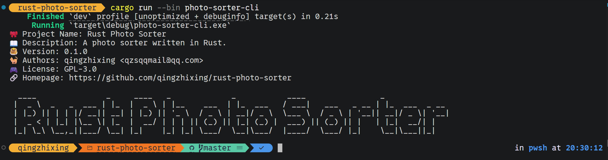

# rust-photo-sorter

[](https://github.com/qingzhixing/rust-photo-sorter/actions/workflows/ci.yml)

## 🍳 Display



## 🔗 Description

🎀 Rust + egui 实现的照片分类程序

## 🚀 用法

```powershell
# 先看它打算怎么搬（不动任何文件）
cargo run --release -p photo-sorter-cli -- -i "D:\照片" -o "D:\已分类" --dry-run

# 确认无误后真移动
cargo run --release -p photo-sorter-cli -- -i "D:\照片" -o "D:\已分类"
```

| 参数 | 说明 |
| --- | --- |
| `-i, --input-dir` | 输入目录，必填 |
| `-o, --output-dir` | 输出目录，**不填则与输入目录相同**（原地整理） |
| `--extract` | 提取模式：把整棵目录树的照片平铺到输出目录根，并删除因此变空的目录 |
| `--sort-type` | 确实没有拍摄日期的照片怎么办：`by-modification-date` / `by-single-folder`（默认）/ `do-not-move` |
| `--no-filename-date` | 不从**文件名**里解读拍摄日期（默认会解读，见下） |
| `-t, --photo-count-threshold` | 照片数量阈值，默认 20 |
| `--dry-run` | 只列计划，不动文件（与 `--copy` 互斥）；明细打到 stdout，可 `> 计划.txt` 保存 |
| `--copy` | 复制而非移动，保留源文件 |

日志级别由 `RUST_LOG` 控制（如 `$env:RUST_LOG="debug"`）。
**release 构建默认静默**，只有显式设置 `RUST_LOG` 才输出；结论摘要与试运行明细走 stdout，不受影响。

## 🖥️ 图形界面

```powershell
cargo run -p photo-sorter-gui
```

在命令行那套配置之上，界面里可以直接**执行**：

| 执行方式 | 行为 |
| --- | --- |
| 试运行（只列计划） | 只统计「打算怎么搬」，不碰任何文件 |
| 移动 | 搬到目标位置（默认），源文件不再保留 |
| 复制 | 复制到目标位置，源文件保留 |

- 整理跑在后台线程上，界面不会卡住：执行中会显示进度条、已处理数量与最近处理的文件。
- 结果面板给出一行统计（扫描/跳过/成功/失败/清理空目录/耗时），
  失败的文件逐条列出「从哪来、本来要去哪、为什么没成功」。
- **计划明细**折叠区列出每一条「哪张 → 哪张（进哪类目录）」和「哪张没动、为什么」，
  试运行时这份清单就是主要产出；鼠标悬停某一行能看到两头的完整路径。
- 试运行的结果会明确标注「文件没有被改动」，避免把计划误当成已完成的搬运。
- 界面日志同样受 `RUST_LOG` 控制，默认静默（双击启动时日志无处可去，属预期行为）。
- 顶栏右上角的「版本」打开**版本页**，内容与 `photo-sorter-cli -V` 相同
  （项目名 / 描述 / 版本 / 作者 / 许可 / 主页）；两者都取自 core 的 `info::INFO_ROWS`，
  是同一份清单，不会各说各话。主页那一行是链接，点一下用系统默认浏览器打开。
  点「← 返回」回到配置页。

## 📁 分类规则

有拍摄日期的照片按 **ISO 周**归档：

```
输出目录/
├── 2026.07.27 至 08.02 第31周/   ← 该周内未超阈值的日子
│   └── IMG_0001.jpg
└── 2026.07.30/                    ← 这天照片数超过阈值，单独成目录（与周目录平级）
    ├── IMG_0001.jpg
    └── IMG_0001 (1).jpg           ← 不同子目录的同名文件，追加序号
```

- 拍摄日期依次取自 **EXIF**（`DateTimeOriginal` → `DateTimeDigitized` → `DateTime`）
  和**文件名**（可用 `--no-filename-date` 关掉）。
  文件名这一路默认开启，专治截图类工具：Steam 截图没有 EXIF，但文件名形如
  `1629520_20260911110905_1.png`。识别这些形态：
  `YYYYMMDDHHMMSS`、`YYYYMMDD_HHMMSS`、`YYYY-MM-DD_HHMMSS`、以及只有日期的 `YYYYMMDD`。
  EXIF 与文件名都没有时，才轮到 `--sort-type`。
- 确实没有拍摄日期时按 `--sort-type` 处理：
  - `by-single-folder`（默认）→ 放进 `无拍摄日期/`
  - `by-modification-date` → 用文件修改时间（拷来拷去的文件，修改时间往往已经不是拍摄时间了）
  - `do-not-move` → 原地不动
- 输出目录嵌在输入目录里时，扫描会跳过它，避免重复运行把已归档的照片再排一遍。

## 🧱 代码结构

```
crates/
├── core/   # 扫描 → 规划 → 落地，CLI 与 GUI 共用同一套规则
├── cli/    # 命令行前端
└── gui/    # egui 前端（配置 + 执行 + 进度）

assets/
├── font/   # GUI 内嵌的中文字体（include_bytes!）
└── icon/   # 程序图标：icon.svg 是矢量源图，icon.ico / icon.png 是它的产物
```

Windows 的 exe 图标走 `build.rs` + `winresource`：把 `assets/icon/icon.ico` 编进 exe 的资源段，
CLI 与 GUI 各一份（十几行，有意重复而不是抽公共 crate）。
`.ico` 里放了 7 档尺寸（16 / 24 / 32 / 48 / 64 / 128 / 256），
少一档的话 Explorer 那一档视图就会被系统硬放大、发糊。

图标源图是矢量的 `icon.svg`，`icon.ico` 与位图母版 `icon.png` 都是它生成的；
仓库里只放生成好的这两个文件，不放生成脚本，出图的办法写在 `crates/gui/build.rs` 的注释里。
关键一点是每一档都单独从矢量渲染，而不是渲一张大图再缩——16×16 那档两者平均差 17/255。

只有 Windows 的图标是「可执行文件自带」的：macOS 的图标属于 `.app` 包、Linux 的属于 `.desktop`
文件，都不是裸可执行文件能带的，所以那两个平台目前没有图标。

Core 的 `worker::run` 接受一个可选的 `Observer`：CLI 在试运行时传一个把明细打到 stdout 的实现，
GUI 传一个把进度与明细转发给界面的实现（不传就是闷头干完再返回报告）。
「怎么搬」只有一处实现，两个前端不会走出两套行为。

## ✅ 测试

本地跑和 CI 跑的是同一套命令：

```powershell
cargo test --workspace --locked                              # 全部单元测试
cargo fmt --all -- --check                                   # 格式
cargo clippy --workspace --all-targets --locked -- -D warnings   # lint，警告即失败
```

`.github/workflows/ci.yml` 在推送到主干、提 PR 和手动触发时运行：

- **测试**：Ubuntu 与 Windows 各跑一遍 `cargo test --workspace --locked`。
  core 里有按平台分叉的代码（跨盘移动的错误码、release 版 GUI 把日志接回控制台），
  只在一个平台上跑等于少覆盖一半。
- **格式与 lint**：Ubuntu 上跑 rustfmt 与 clippy（警告即失败）。
- Linux 上编译 GUI 需要 X11/Wayland 的头文件，workflow 里那步 `apt-get install` 就是为它准备的。
- 依赖上要求 **rustc ≥ 1.95**（eframe 0.36 的 MSRV；edition 2024 本身要 1.85+），
  所以 CI 用 `stable` 而不是钉死某个旧版本。

## 📦 发布

打个 tag 就会自动编译发版：

```powershell
git tag v0.1.0        # 正式版
git tag v0.2.0-rc.1   # 预发布：去掉开头的 v 之后还带 `-` 的 tag 会自动标成 Pre-release
git push origin --tags
```

`.github/workflows/release.yml` 先在三个系统上各跑一遍测试，再按
**平台 × 档位（release / debug）** 编译打包，一共 16 个包挂到 GitHub Release
（4 个平台 × 2 档 × cli / gui 两个程序）。Release 先建成草稿、等资产传完才转正，
别人不会看到「传到一半」的版本：

| 平台 | 编译目标 | 归档 |
| --- | --- | --- |
| Windows x86_64 | `x86_64-pc-windows-msvc` | `.zip`，额外带 `.pdb` |
| Linux x86_64 | `x86_64-unknown-linux-gnu` | `.tar.gz` |
| macOS Apple Silicon | `aarch64-apple-darwin` | `.tar.gz` |
| macOS Intel | `x86_64-apple-darwin` | `.tar.gz` |

每个平台的每个档位各出 cli 与 gui 两个包，命名形如：

```
photo-sorter-cli-v0.2.0-rc.1-x86_64-unknown-linux-gnu-release.tar.gz
photo-sorter-gui-v0.2.0-rc.1-x86_64-pc-windows-msvc-debug.zip
```

- 解压出来是一层同名文件夹，里面是程序 + readme + LICENSE。
  **符号文件只跟 debug 档走**：Windows 的 debug 包多一个 `.pdb`，macOS 的 debug 包多一个 `.dSYM`。
  MSVC 与 macOS 都把调试信息存在这种独立文件里，不带上它们，debug 包就只剩「没做优化的 exe」，
  行号、变量、源码路径全没了。
- release 档**不带**符号文件：release profile 默认 `debug = false`，此时的 `.pdb` 只有公开符号、
  没有行号，却会让 CLI 的下载量翻倍。去掉后 Windows 的 CLI 包从 1.38 MB 降到 0.85 MB，
  GUI 包从 13.5 MB 降到 11.6 MB。
- **debug 档**用的是 cargo 默认的 dev profile（不能写 `--profile debug`：cargo 把 `debug` 当保留字），
  体积明显更大：Windows 上 GUI 的 debug 包约 72 MB，其中约八成就是那个 `.pdb`。
- **Linux** 的包是在 ubuntu-latest 上编的，要求 glibc ≥ 2.39；GUI 还需要系统里有 X11 / Wayland，
  以及桌面 portal（文件对话框走 xdg-portal）。
- **macOS** 从浏览器下载的文件会带 quarantine 属性，第一次打开要
  `xattr -dr com.apple.quarantine photo-sorter-gui`，或者右键 → 打开。
- 手动触发（Actions → Release → Run workflow）只编译，产物留在这次运行的 Artifacts 里，
  不动 Release——想拿一份当前 master 的 debug 包、又还不想打 tag 时用这个。
- 想砍掉某个平台（比如不要 Intel Mac），把 `release.yml` 构建矩阵里对应的两行删掉即可。
